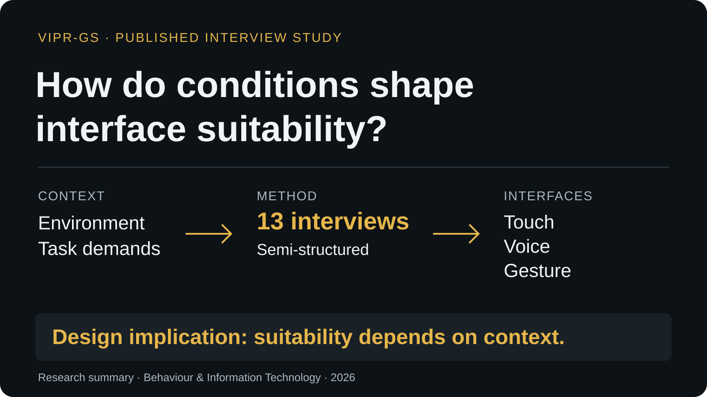

# Soldier–Vehicle Interaction & Natural User Interfaces

**Raphael Ugboko · VIPR-GS project · DRIVE Lab, Clemson University**

I organized research material, analyzed evidence and refined the manuscript for a published qualitative study of natural user interfaces. I also built a Unity 3D environment to help explore NUI use under changing terrain, noise and weather conditions.

**[Portfolio case study](https://ralphugboko.dev/projects?discipline=ux-research&project=soldier-vehicle-interaction)** · **[Published paper](https://doi.org/10.1080/0144929X.2026.2734080)** · **[Unity work](docs/unity-environment.md)**

## Research question

Which interaction methods fit the conditions in which people actually work?

The published study examined environmental impediments and operational constraints in soldier–vehicle interaction, considering touch, voice and gesture interfaces. It used exploratory semi-structured interviews with **13 participants** who had soldier–vehicle interaction experience.

## My research work

My work covered **data curation, formal analysis, and manuscript review and editing**. I prepared research material, interpreted evidence and refined the research argument with the authors.

The published implication is that operating context and task demands influence interface suitability. This supports investigating multimodal interaction and alternatives instead of assuming one universally appropriate input method.

[Research methods and sample](docs/research-study.md)

## My Unity prototyping work

I built a Unity 3D environment with terrain and added sound and visual effects representing noise, cloudy weather and rain. The environment was intended to help test how people react to NUIs under different conditions.

This simulation work and the published interview study are identified separately. [Implementation overview](docs/unity-environment.md).

## Repository contents

- `docs/research-study.md`: published method, research responsibilities and participant-table evidence.
- `docs/unity-environment.md`: my environment implementation and intended evaluation use.
- `assets/`: the study-summary visual and the approved participant-table image from the published paper.
- `ATTRIBUTION.md`: publication and artifact references.

This repository contains public research documentation and selected artifacts. Internal project reports, participant records and unpublished findings are excluded.

## Publication

Christopher Lawson, Md Atik Enam, Ethan Butler, Raphael Ugboko, Dustin J. Souders, Jerome McClendon and Julian Brinkley. **Soldiers’ perspectives on natural user interfaces in combat vehicle operations.** *Behaviour & Information Technology*. Published online September 24, 2026.

[Publisher record](https://doi.org/10.1080/0144929X.2026.2734080) · [Publications page](https://ralphugboko.dev/publications#selected-soldier-nui)
