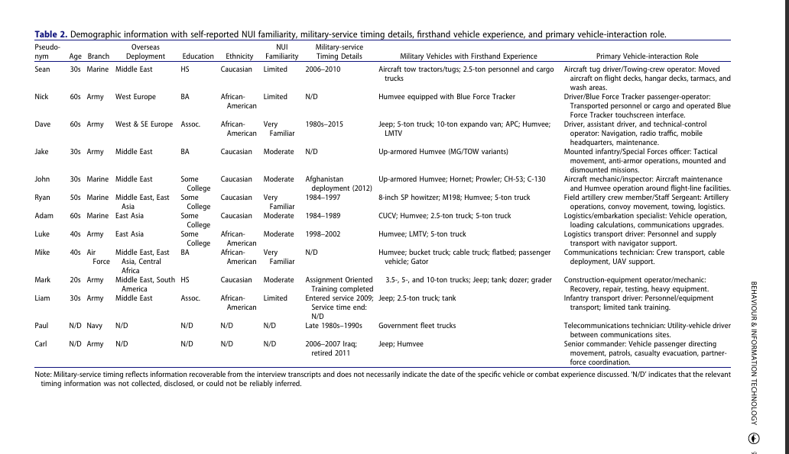

# Research study

## Question and method

The published study examined how environmental impediments and operational constraints shape soldier–vehicle interaction and the suitability of touch, voice and gesture interfaces.

The team used exploratory semi-structured interviews with 13 participants who had soldier–vehicle interaction experience. Interviews allowed the research to examine work context and practical constraints through participants’ accounts.

## My work

- **Data curation:** I prepared and organized research material for analysis.
- **Formal analysis:** I interpreted research evidence and developed the reasoning behind the findings with the team.
- **Research communication:** I reviewed and refined the manuscript to communicate a clear, supported research argument.

## Study sample

The following image is Table 2 from the published paper. It uses pseudonyms and summarizes participants’ backgrounds, NUI familiarity and vehicle experience.

## Published implication

Interface suitability depends on operating context and task demands. The design implication is to consider multimodal interaction and alternatives when investigating vehicle interfaces.

The linked publication supports the study summary and author contribution statement. The [Unity implementation overview](unity-environment.md) describes my prototyping work independently of the interview method.

[Published paper](https://doi.org/10.1080/0144929X.2026.2734080) · [Portfolio case study](https://ralphugboko.dev/projects?discipline=ux-research&project=soldier-vehicle-interaction)
